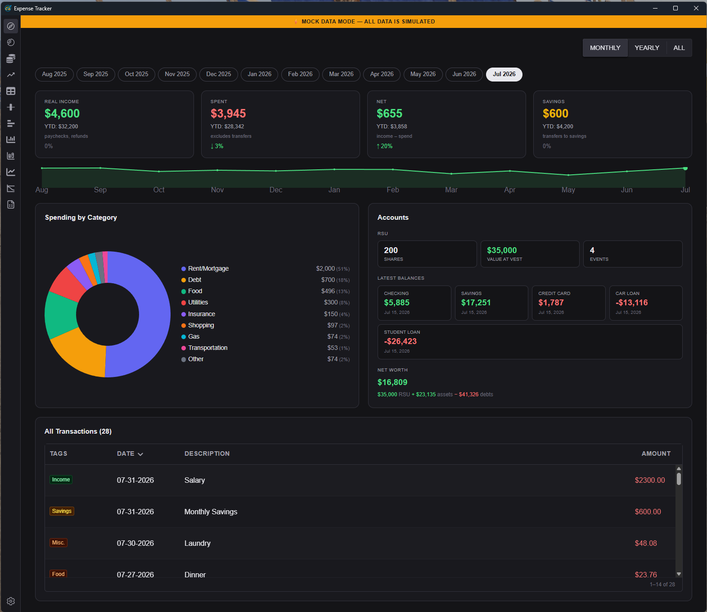

# Expense Tracker V2


Expense Tracker V2 is a desktop application for personal finance management, built with a Rust backend using Tauri and a React frontend. It provides tools for importing, visualizing, analyzing, and managing your financial data locally and securely.



## Features

- **Cross-Platform:** Runs on Windows, macOS, and Linux thanks to the Tauri framework.
- **Local & Private:** All data is stored on your machine using `tauri-plugin-store`. Nothing leaves your computer.
- **Auto-Updates:** Signed releases are published to GitHub; the app checks for and installs updates itself.

### Importing & data management

The **Data** page is the single home for all data I/O:

- **CSV Import:** Pick a file, choose a format, and parse. Predefined formats cover providers like Wells Fargo, American Express, and Capital One; custom formats are supported. Entries that already exist are skipped (each expense is identified by a deterministic hash of its description, date, and amount). Import dates are recorded and shown as markers on the date scrubber.
- **CSV Format Designer:** Preview a CSV, build or edit custom format definitions, and run a parse preview before importing.
- **Export & Backup:** Export expenses to CSV, or back up and restore the full dataset (expenses, accounts, RSU, forecast config, etc.) as JSON.

### Transactions

- **Transactions table:** A virtualized, sortable table with a search box, type filters (expenses / income / savings), and a rule-based filter builder (AND/OR conjunctions over fields such as amount, tag, group, description, date).
- **Full CRUD** with bulk edit, bulk delete, bulk tagging, and bulk group assignment.
- **Quick wheel:** A radial action menu on table rows for fast tagging and actions.
- **Auto-categorize:** Suggests tags or groups for uncategorized entries by matching their descriptions against ones you've already categorized; review and accept suggestions in bulk.
- **Global search** (`Ctrl/Cmd+K`) across transactions.

### Tags, groups & classification

- **Tags** describe *what* the money was (Food, Gas, …).
- **Groups** are a second, orthogonal dimension describing *what it was part of* (e.g. "Japan Trip", "Bathroom Reno"). An entry belongs to at most one group.
- **Classification:** Entries are classified as Income, Savings, or Expense by their group (the reserved `Income` and `Savings` groups), with a fallback for legacy `Income`/`Savings` tags on older data. Income and savings entries can carry real tags too.
- **Groups page:** A card per group with its signed total, drilling into a detail view with insights, rename, and clear-group actions.
- **Settings** let you disable individual tags and groups so they are excluded from charts and the overview.

### Visualization (pure D3/SVG)

All charts are custom-built with D3 and SVG. Hover tooltips show label and value, and **double-clicking a bar or segment drills into the Transactions table**, pre-filtered to that category and period.

- **Overview:** Summary cards for income, spending, net, and savings (each with previous-period and year-to-date deltas), a spending-by-tag donut, month navigation, a net-worth sparkline, and an investments card.
- **Charts gallery:** A grid of chart types with preview thumbnails, opening full-page:
  - Average Monthly Spending (tags or groups)
  - Income vs Expenses
  - Date Grouped Expenses (daily / monthly / yearly)
  - Expenses by Tag (stacked, tags or groups)
  - Year To Date
  - Cash Flow Sankey
- **Date range:** A brush scrubber at the bottom of data pages selects the range for all views, with a date-picker modal for precise control.

### Planning & analysis

- **Forecast:** A daily cash-flow projection built from income streams (weekly, bi-weekly, semi-monthly, monthly, …) and recurring expenses, with a starting balance and reserve.
- **Anomaly Detection:** Flags a category's month when its total is far above that category's normal month. The "typical" amount is the **median of the trailing N months** (default 12); a month is flagged when it exceeds **X times** typical or **$Y over** typical. Thresholds and window are configurable under Settings and persist across restarts. Double-click a flagged row to drill into the transactions.

### Net worth & income tracking

- **Accounts:** Track net worth via asset and debt balance snapshots over time.
- **RSU:** Stocks, grants with vesting schedules, vests, settlements, sales, appreciation, and forecasts. The tab appears when enabled in Settings or when data exists.
- **SSDI:** Track SSDI income deposits against monthly SGA (substantial gainful activity) limits. Same visibility rule as RSU.

### Navigation

- A collapsible **side rail** grouped into sections, with Settings fixed at the bottom.
- **Keyboard shortcuts** (press `?` in the app for the full list): `↑`/`↓` move between pages, `1`–`9`/`0` jump to a page, `n` new expense, `i` import CSV, `s` settings, `Ctrl/Cmd+K` search.

### Mock Data Mode

A settings toggle replaces **all data** with simulated sample data at the service layer, so no page or hook is mock-aware. Edits work in memory but are never persisted, and a banner indicates the simulated state. The same mode powers the browser-hosted demo build (`npm run build:demo`), which is deployed to GitHub Pages from `master`.

## Tech Stack

- **Backend:** Rust, Tauri v2 (`tauri-plugin-store`, dialog, opener, updater, process)
- **Frontend:** React 19, TypeScript (strict), Vite 7
- **UI & Styling:** Chakra UI v3, SCSS modules
- **State Management:** RxJS `BehaviorSubject` stores with custom React hooks
- **Charting:** D3.js with custom SVG rendering
- **Routing:** React Router v7
- **Other:** date-fns, `@tanstack/react-virtual`

## Architecture

- **Service layer:** All backend access goes through the `ExpenseTrackerService` interface (`src/services/`). `TauriService` is the only file importing `@tauri-apps/*`; `MockService` is an in-memory implementation used for mock mode and the demo. A different backend (e.g. HTTP) can be supplied by implementing the same interface.
- **Props-driven components:** Pages call hooks and transform data; cards and charts render purely from props, so they can be reused with differently filtered data.
- **Classification** goes through a single function (`getExpenseKind`), so income, savings, and expense totals agree everywhere.

## Project Structure

The repository contains both the frontend and backend:

- `src/`: The React/TypeScript frontend.
  - `pages/`: One directory per page (Overview, TableView, Groups, Accounts, Forecast, Anomalies, Charts, RSU, SSDI, Data, Settings).
  - `components/`: Shared UI, including the chart primitives, data table, modals, and side navigation.
  - `services/`: The service interface plus Tauri and mock implementations.
  - `store/`: RxJS stores (settings, filters, selection, overlays, date range).
  - `utils/`: Pure logic (classification, forecasting, anomalies, auto-categorize, filter rules, RSU forecasting).
  - `types/`: Shared types, route/nav definitions, and mock data generators.
- `src-tauri/`: The Rust backend: store persistence, CSV parsing and format definitions, expense CRUD commands, and app lifecycle.

## Getting Started

### Prerequisites

- **Rust:** Install via [rustup](https://rustup.rs/).
- **Node.js:** Install Node.js and `npm`.
- **Tauri prerequisites:** Platform-specific system libraries are listed in the [Tauri docs](https://tauri.app/start/prerequisites/).

### Installation & Setup

1.  Clone the repository:

    ```shell
    git clone https://github.com/nikcich/ExpenseTrackerV2.git
    cd ExpenseTrackerV2
    ```

2.  Install the frontend dependencies:

    ```shell
    npm install
    ```

## Usage

### Development

Run the full desktop app with hot reload:

```shell
npm run tauri dev
```

Or run just the frontend in a browser:

```shell
npm run dev
```

### Type-check and bundle

```shell
npm run build
```

### Building for Production

```shell
npm run tauri build
```

### Demo build

Build the browser-only demo (runs entirely on mock data):

```shell
npm run build:demo
```

## Releases

Pushing a `rel-<version>` branch triggers the GitHub Actions release workflow, which builds installers for Linux (AppImage, deb), Windows (NSIS, MSI), and macOS (dmg, app), signs the updater artifacts, and publishes a tagged GitHub release with a `latest.json` the in-app updater reads.
